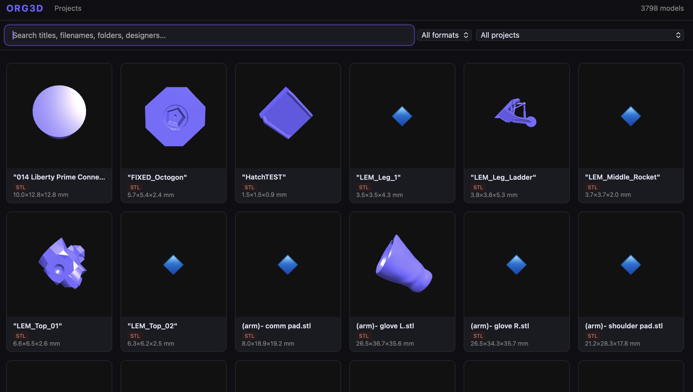
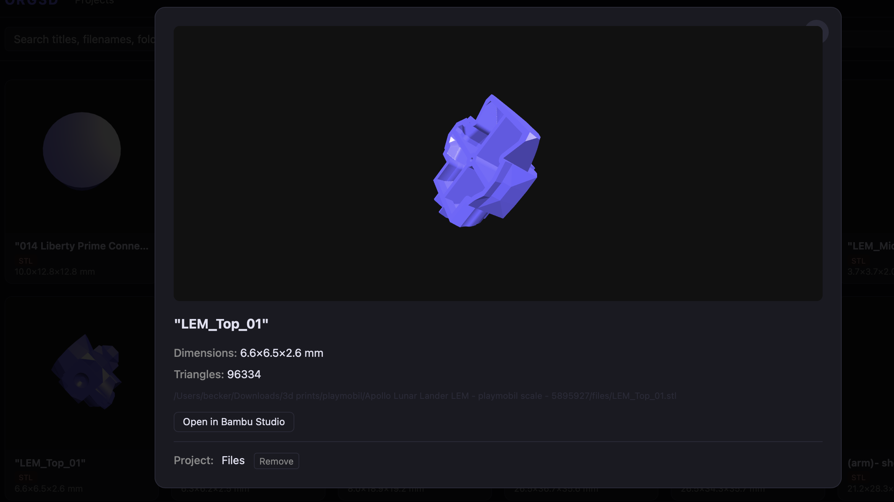

# org3d

A local gallery and organiser for 3D print files. Scans a directory of 3MF and STL files, extracts metadata, and serves a searchable web UI with 3D previews.





## Features

- **Browses 3MF and STL files** — extracts title, designer, description, dimensions, triangle count, and embedded thumbnails from 3MF files
- **Full-text search** — searches titles, designers, descriptions, filenames, folders, and project names
- **3D preview** — interactive WebGL viewer with mouse rotation and zoom; auto-captures thumbnails on first view
- **Projects** — group related models together; type-ahead autocomplete on assignment
- **Open in slicer** — one click opens the file in Bambu Studio, OrcaSlicer, or PrusaSlicer
- **Settings UI** — configure folder, port, database path, and slicer preference; changes apply without restarting
- **Rescan** — re-index after adding new files, triggered from the Settings page or on startup
- **Autogroup** — automatically creates projects from shared folder names
- **Extract** — unpacks ZIP archives and re-scans in one step
- **Duplicates** — finds byte-identical copies and moves the ones you pick to `.org3d-trash` in the library; the kept copy takes over the project and thumbnail
- **Rename** — renames files to `Designer - Title.3mf` based on embedded metadata (CLI, dry-run by default)

## Install

### macOS (Apple Silicon)

Download the latest `.dmg` from the [Releases page](../../releases), open it, and drag **org3d.app** to your Applications folder.

Because org3d is not signed with an Apple Developer certificate, macOS will quarantine the downloaded app. Remove the flag before launching:

```bash
xattr -dr com.apple.quarantine /Applications/org3d.app
```

Then open org3d from Spotlight or your Applications folder. On first launch it opens the Settings page — set your base folder and click **Save**.

> org3d currently ships as an Apple Silicon (M1+) binary only.

### CLI (all platforms)

```bash
cargo build --release
```

The binary is at `target/release/org3d`. No other dependencies required — SQLite is bundled.

### Docker / Unraid

A headless server image is built from the `Dockerfile` and published to `ghcr.io/sbeckeriv/org3d`. On Unraid, add `unraid/org3d.xml` as a template (Docker → Add Container → Template, or copy it to `/boot/config/plugins/dockerMan/templates-user/`).

```bash
docker run -d --name org3d -p 3000:3000 -e TZ=America/Los_Angeles \
  -e ORG3D_AUTH='me:a-long-password' -e ORG3D_RESCAN_AT=04:00 \
  --read-only --cap-drop ALL --security-opt no-new-privileges \
  --memory 2g --pids-limit 256 \
  -v /mnt/user/appdata/org3d:/config \
  -v /mnt/user/3d-prints:/library:ro \
  ghcr.io/sbeckeriv/org3d:latest
```

**Disk spin-down.** org3d leaves array disks asleep unless it actually needs a file:

- Nothing watches or polls the library. Scans run once on first start (if the DB is empty), then only when you click **Rescan** or at `ORG3D_RESCAN_AT`.
- A rescan reads only directory metadata (size and mtime) and opens only new or changed files. Install the **Dynamix Cache Directories** plugin to keep the library's directories in RAM. A rescan of an unchanged library then wakes no disks at all.
- Database, thumbnails and the 3D preview cache live in `/config`. Put it on the cache pool. Viewing a model a second time is served from the cache, so its disk stays asleep. Browser revalidation uses ETags taken from the DB.
- Downloading a file, or opening a model's 3D preview for the first time, wakes the disk that holds it.
- **Find duplicates** reads only files that share an exact size with another file, and remembers each result, so later runs read only new or changed files. The first run may wake several disks.
- Moved or renamed files keep their project, matched by size and mtime. Files that vanish are hidden, not deleted, so a disk that drops out of the array doesn't lose your projects. A scan that would hide more than 25% of the library at once is refused. Hidden rows are purged after `ORG3D_PURGE_MISSING_DAYS` (default 30).

**Security.**

- **Login.** Set `ORG3D_AUTH=user:password` to require a login for everything except the health check. Without it, anyone who can reach the port can rescan, extract into the library and change projects; the server logs a warning at startup. Basic auth over plain HTTP can be sniffed on your LAN, so use a password you don't use elsewhere. For access from outside the LAN, use a reverse proxy with TLS. Failed logins are logged and delayed by a second.
- **Cross-site requests.** Cross-site POSTs are rejected.
- **Container.** The image runs as 99:100 (nobody:users) and only writes to `/config` (and `/library` for **Extract ZIPs** and **Duplicates**), so it works with `--read-only`, `--cap-drop ALL` and `no-new-privileges`. The Unraid template sets these, plus a 2 GB memory cap. Mount `/library` read-only unless you use **Extract ZIPs** or **Duplicates**.
- **Untrusted files.** Large models are parsed and previewed with constant memory where possible; at most 2 3MF previews are converted at once. ZIP and 3MF entries are capped (1 GiB per 3MF part, 8 GiB per extracted file, 32 GiB per archive) and anything compressed more than 200× is rejected as a likely zip bomb.

| Variable | Default (image) | |
|---|---|---|
| `ORG3D_LIBRARY` | `/library` | Library folder |
| `ORG3D_DB` | `/config/org3d.db` | SQLite database |
| `ORG3D_THUMBS` | `/config/thumbs` | Thumbnails |
| `ORG3D_CACHE` | `/config/cache` | 3D preview cache |
| `ORG3D_PREVIEW_CACHE_MB` | `1024` | Preview cache cap (0 = off) |
| `ORG3D_RESCAN_AT` | unset | Daily rescan `HH:MM` in `TZ` |
| `ORG3D_PURGE_MISSING_DAYS` | `30` | Days before vanished files are dropped (0 = never) |
| `ORG3D_PORT` / `ORG3D_BIND` | `3000` / `0.0.0.0` | Listen address |
| `ORG3D_AUTH` | unset | `user:password` login (password ≥ 8 chars) |

## Building from Source

### Desktop app (Tauri)

**Prerequisites:** Rust stable, and [Tauri v2 system dependencies](https://v2.tauri.app/start/prerequisites/) for your platform.

```bash
# Install the Tauri CLI (one-time)
cargo install tauri-cli --version "^2" --locked

# Build a release bundle
cargo tauri build
```

On macOS this produces a `.dmg` and a signed `.app` under `target/aarch64-apple-darwin/release/bundle/`. On Linux it produces a `.deb` and `.AppImage`; on Windows an `.msi` and `.exe` installer.

To run the app in development (hot-reloads the Rust server, not the Tauri shell):

```bash
cargo tauri dev
```

### CLI only

```bash
cargo build --release --package org3d
```

## CLI Usage

### Quick start

```bash
org3d run ~/Downloads/3d-prints
```

Scans on first run, then serves the gallery at [http://localhost:3000](http://localhost:3000). On subsequent runs it skips the scan unless `--rescan` is passed.

### Commands

```
org3d scan <path>              Index all 3MF/STL files under <path>
org3d serve <path>             Start the gallery (no scan)
org3d run <path>               Scan if empty, then serve
org3d rename <path>            Preview metadata-based renames (--apply to execute)
org3d extract <path>           Unpack ZIPs (--scan to re-index immediately)
org3d autogroup                Create projects from folder names
```

### Options

```
--db <path>                 SQLite database file        [env: ORG3D_DB, default: org3d.db]
--thumbs <path>             Thumbnail directory         [env: ORG3D_THUMBS, default: thumbs]
--port <port>               Port for serve/run          [env: ORG3D_PORT, default: 3000]
--bind <addr>               Listen address              [env: ORG3D_BIND, default: 0.0.0.0]
--cache <path>              3D preview cache directory  [env: ORG3D_CACHE, default: cache]
--preview-cache-mb <n>      Preview cache cap, 0 = off  [env: ORG3D_PREVIEW_CACHE_MB, default: 1024]
--rescan-at <HH:MM>         Daily rescan time           [env: ORG3D_RESCAN_AT]
--purge-missing-days <n>    Drop vanished files after n days, 0 = never  [default: 30]
```

`org3d run` serves immediately and scans in the background if the database is empty. `org3d scan` refuses to hide a large share of the library at once, since that usually means a disk is offline. Pass `--allow-mass-missing` if you really deleted those files.

### Examples

```bash
# First time setup
org3d run ~/Downloads/3d-prints --port 8080

# Force a rescan after adding new files
org3d run ~/Downloads/3d-prints --rescan

# Preview what rename would do
org3d rename ~/Downloads/3d-prints

# Rename files to match their embedded metadata
org3d rename ~/Downloads/3d-prints --apply

# Unpack any .zip files, then scan
org3d extract ~/Downloads/3d-prints --scan

# Group models into projects based on their folder structure
org3d autogroup
```

## Resetting the database

```bash
rm org3d.db org3d.db-shm org3d.db-wal
org3d run ~/Downloads/3d-prints
```

## Supported formats

| Format | Metadata | Thumbnail | 3D preview |
|--------|----------|-----------|------------|
| 3MF    | ✓        | ✓         | ✓          |
| STL    | —        | captured on first view | ✓ |

3MF metadata extraction handles both standard single-file 3MFs and Bambu Studio's multi-file layout (`3D/Objects/*.model`). Object transforms from the `<build>` section are applied so multi-object files appear correctly positioned in the viewer.

## Tech

- **Rust** — Axum, rusqlite (SQLite + FTS5), roxmltree, clap, tokio
- **Tauri v2** — native desktop shell; bundles the Axum server and opens it in a WebView window
- **Frontend** — HTMX, Three.js, vanilla JS; no build step
- **Templates** — minijinja (Jinja2-compatible, compiled into the binary)
